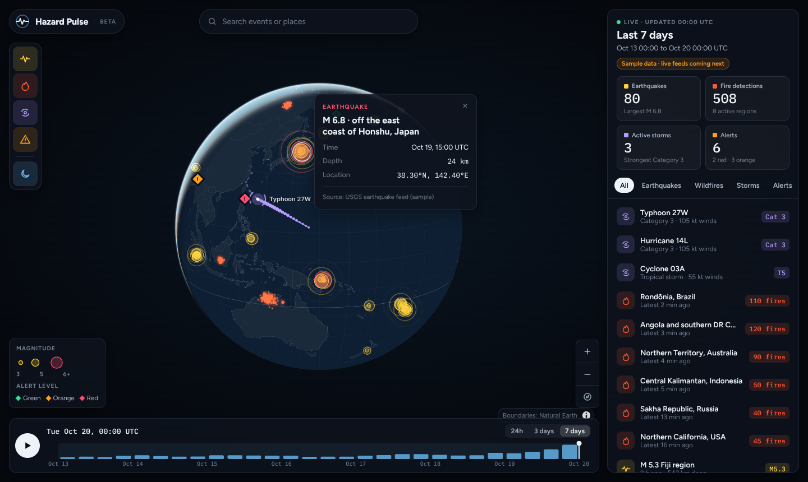

# Hazard Pulse

A live disaster and hazard monitor: earthquakes, wildfires, tropical storms and disaster alerts on an interactive 3D globe, with a timeline you can scrub and play back.

**Live site:** https://avintha97.github.io/hazard-pulse/ (after the first deploy, see [Deploying](#deploying))



> The dashboard currently runs on **sample data** shaped like the real feeds. Connecting the live feeds is the next step (see [Roadmap](#roadmap)).

## Features

- Dark, frosted-glass globe built with MapLibre GL JS, with a day/night shadow
- Four hazard layers you can switch on and off: earthquakes, wildfires, storms, alerts
- Event panel with live KPI tiles, type tabs, search, and click-to-fly
- Popups with event details (magnitude, depth, fire power, wind speed, people affected)
- Timeline of events per 6 hours (ECharts) with drag-to-scrub, play/pause and 24h / 3 day / 7 day windows
- Works on phones: the event panel becomes a bottom sheet

## Tech stack

| Part | Tool |
| --- | --- |
| Build and dev server | [Vite](https://vite.dev) |
| Language | TypeScript |
| Map | [MapLibre GL JS](https://maplibre.org) (globe projection) |
| Charts | [Apache ECharts](https://echarts.apache.org) |
| Country outlines | [Natural Earth](https://www.naturalearthdata.com) via [world-atlas](https://github.com/topojson/world-atlas) |
| Hosting | GitHub Pages, deployed by GitHub Actions |

No map tile server or API key is needed: the basemap is drawn from Natural Earth outlines bundled with the app.

## Run it on your computer

You need [Node.js](https://nodejs.org) 22 or newer.

```bash
git clone https://github.com/avintha97/hazard-pulse.git
cd hazard-pulse
npm install
npm run dev
```

Then open http://localhost:5173/hazard-pulse/ in your browser. The page reloads by itself when you save a file.

| Command | What it does |
| --- | --- |
| `npm run dev` | Start the local dev server |
| `npm run build` | Type-check and build the site into `dist/` |
| `npm run preview` | Serve the built `dist/` folder to check it before deploying |
| `npm run typecheck` | Only run the TypeScript checks |

## Project structure

```
hazard-pulse/
├── index.html              Page layout: brand, search, layer rail, legend, panel, timeline
├── public/                 Files copied as-is (favicon)
├── src/
│   ├── main.ts             Starts the app and wires the parts together
│   ├── state.ts            Small store: layers, time window, selection, plus helpers
│   ├── time.ts             Time constants and date formatting (all UTC)
│   ├── data/
│   │   ├── index.ts        loadDataset(): the one place live feeds plug in
│   │   ├── sample.ts       Seeded sample data shaped like USGS, FIRMS and GDACS
│   │   └── types.ts        Types for quakes, fires, storms and alerts
│   ├── map/
│   │   ├── index.ts        Creates the MapLibre globe, popup and selection ring
│   │   ├── basemap.ts      Self-hosted dark style, world outlines, day/night shadow
│   │   └── hazards.ts      Hazard layers, storm and alert markers, click picking
│   ├── ui/
│   │   ├── panel.ts        KPI tiles, tabs, search and event list
│   │   ├── rail.ts         Layer toggles
│   │   ├── timeline.ts     ECharts timeline, scrubbing and playback
│   │   ├── popup.ts        Popup content per event type
│   │   ├── format.ts       Colours, escaping and number formatting
│   │   └── icons.ts        Inline SVG icons
│   └── styles/
│       ├── tokens.css      Colours, fonts and sizes in one place
│       ├── app.css         Layout and panels
│       └── map.css         Popup, markers and map controls
├── docs/                   Screenshot for this README
└── .github/workflows/
    ├── ci.yml              Builds every pull request
    └── deploy.yml          Publishes main to GitHub Pages
```

## Deploying

Every push to `main` builds the site and publishes it to GitHub Pages automatically.

One-time setup on GitHub (only needed once):

1. Open the repository on GitHub and go to **Settings → Pages**.
2. Under **Build and deployment → Source**, choose **GitHub Actions**.
3. Go to the **Actions** tab, open **Deploy to GitHub Pages**, and click **Run workflow** (or just push to `main`).

The site then appears at https://avintha97.github.io/hazard-pulse/.

## Data sources

| Layer | Live source (planned) | Key needed |
| --- | --- | --- |
| Earthquakes | [USGS GeoJSON feeds](https://earthquake.usgs.gov/earthquakes/feed/v1.0/geojson.php) | No |
| Wildfires | [NASA FIRMS](https://firms.modaps.eosdis.nasa.gov/api/) VIIRS active fires | Free map key |
| Storms and alerts | [GDACS](https://www.gdacs.org) event feed | No |

API keys go in a `.env.local` file (copy `.env.example`), which git ignores.

## Roadmap

- [ ] Live USGS earthquakes in `src/data/index.ts`
- [ ] NASA FIRMS fire detections
- [ ] GDACS storms and alerts
- [ ] Auto-refresh every few minutes
- [ ] Nearby population for each event (WorldPop / GHSL)
- [ ] Short screen recording for the portfolio
